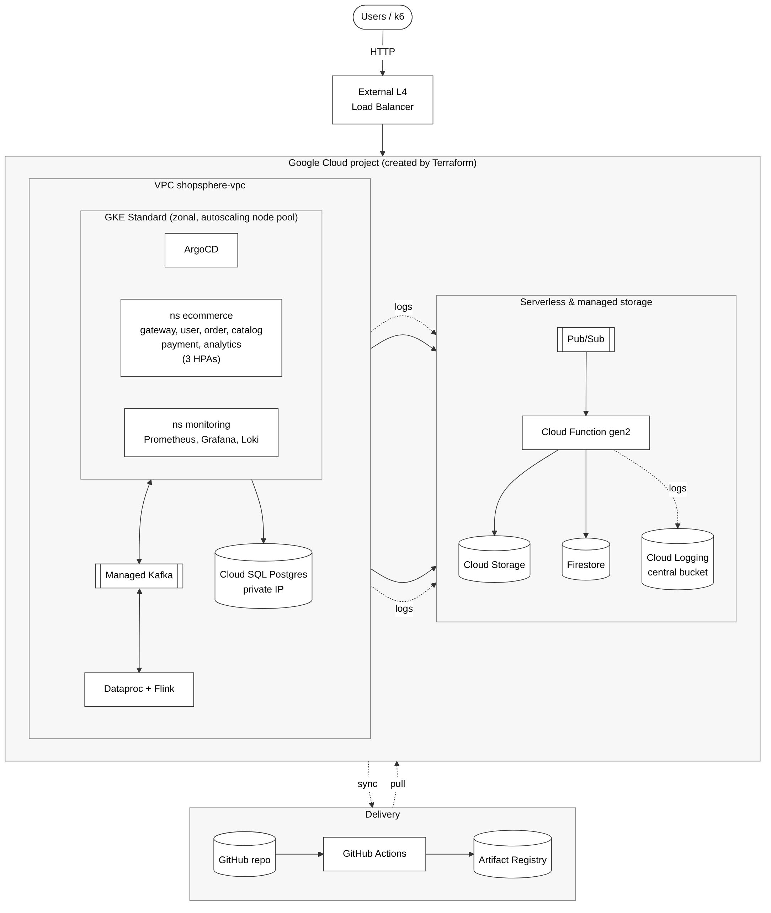
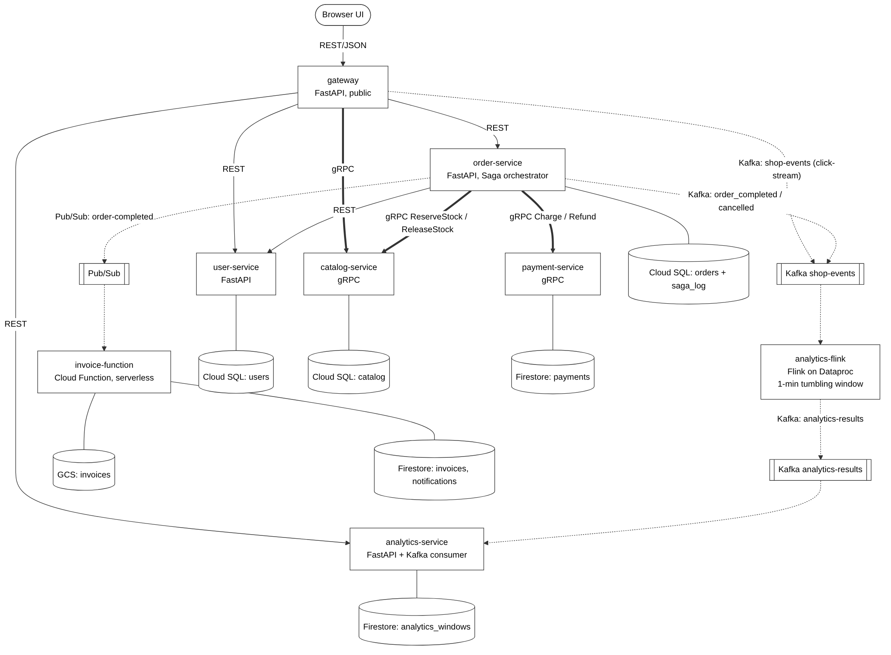
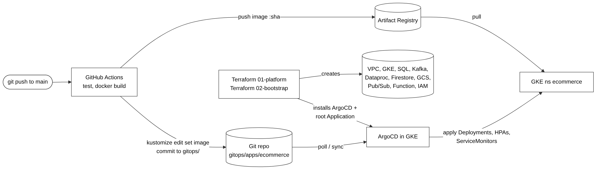

# 1. Introduction

This document describes the design of ShopSphere, the cloud application built by our group for the Cloud Computing assignment. ShopSphere is a small online store. A customer can browse products, add them to a cart and place an order. When an order is placed, stock has to be reserved, payment has to be taken and the order has to be confirmed. These three steps are handled by different services with their own databases, so we used the Saga pattern to keep them consistent. This is the concept we applied for requirement (f).

The application is deployed on Google Cloud Platform (GCP) and is made up of eight microservices:

1. gateway: web front end and API gateway, available on a public URL
2. user-service: customer accounts
3. catalog-service: products and stock
4. order-service: order placement and the Saga orchestrator
5. payment-service: simulated payments
6. analytics-service: serves the real-time analytics results
7. invoice-function: serverless function that creates invoices
8. analytics-flink: Flink job that aggregates events in real time

Services 1 to 6 run on Google Kubernetes Engine (GKE). Service 7 runs on Cloud Functions and service 8 runs on a Dataproc cluster.

## 1.1 Mapping of requirements

Table 1 lists each requirement and where it is implemented in the repository.

| Req. | Implementation | Location in repository |
|---|---|---|
| (a) IaC | All GCP resources and the cluster bootstrap are created with Terraform | infra/terraform/01-platform, infra/terraform/02-bootstrap |
| (b) Serverless and communication | invoice-function is triggered by Pub/Sub. REST, gRPC, Kafka and Pub/Sub are all used | functions/invoice-function, proto/ecommerce.proto |
| (c) Managed Kubernetes, HPA, load test | GKE cluster, HPAs on gateway, order-service and catalog-service, k6 script | gitops/apps/ecommerce/hpa.yaml, loadtest/k6-load.js |
| (d) GitOps | ArgoCD watches the gitops folder of the repository. CI only commits new image tags | gitops/argocd, .github/workflows/build-deploy.yaml |
| (e) Flink on managed cluster | Flink job on Dataproc reads Kafka, does a 1-minute window aggregation and writes to a results topic | analytics-flink, dataproc.tf, kafka.tf |
| (f) Concept | Saga pattern with compensating actions in order-service | services/order-service/saga.py |
| (g) Three storage products | Cloud Storage, Cloud SQL (PostgreSQL), Firestore | storage.tf, sql.tf, firestore.tf |
| (h) Observability | Prometheus and Grafana, Loki, and a central Cloud Logging bucket | gitops/argocd, gitops/apps/observability, logging.tf |

: Table 1: Requirements and their implementation

# 2. Cloud Deployment Architecture

Figure 1 shows how the system is deployed on GCP. All resources are in one GCP project in the us-central1 region and are created by Terraform.

The resources that need private network access are placed in one VPC called shopsphere-vpc:

- **GKE cluster.** A zonal GKE Standard cluster with one node pool of e2-standard-4 machines. The pool autoscales between 2 and 5 nodes. Workload Identity is enabled so that pods can call Google APIs without key files.
- **Cloud SQL.** A Cloud SQL PostgreSQL 15 instance with only a private IP address, connected through Private Service Access.
- **Kafka.** A Google Cloud Managed Service for Apache Kafka cluster connected to the same subnet.
- **Dataproc.** A single-node Dataproc 2.2 cluster with the Flink component. It has no external IP and uses Cloud NAT for outbound traffic.

The other services are fully managed and sit outside the VPC: Pub/Sub, Cloud Functions, Firestore, Cloud Storage, Artifact Registry, Secret Manager and Cloud Logging.

The Terraform code is split into two stages. The first stage (01-platform) creates the GCP resources listed in Table 2. The second stage (02-bootstrap) connects to the new cluster and creates the application namespace, a ConfigMap and a Secret holding the database and Kafka connection details, the ArgoCD installation and the root ArgoCD application. After this, everything inside the cluster is deployed by ArgoCD.

| File | Resources created |
|---|---|
| network.tf | VPC, subnet, firewall rules, Cloud Router and NAT, private service access |
| gke.tf | GKE cluster, node pool, node service account |
| sql.tf | Cloud SQL instance, databases users, catalog and orders, database user |
| firestore.tf, storage.tf | Firestore database, buckets for invoices, Flink jars and function source |
| pubsub.tf, kafka.tf | Pub/Sub topic, Kafka cluster and topics, Kafka client service account |
| dataproc.tf, function.tf | Dataproc cluster with Flink, Cloud Function and its permissions |
| iam.tf, cicd.tf | Workload Identity for pods, Workload Identity Federation for GitHub Actions |
| logging.tf | Central log bucket, log sink, log-based error metric |

: Table 2: Terraform files in stage 01

# 3. Microservices Architecture

Figure 2 shows the services and how they talk to each other. Solid lines are synchronous calls (REST or gRPC). Dotted lines are asynchronous messages (Kafka or Pub/Sub).

## 3.1 Service responsibilities

| Service | Runs on | Interface | Data store | Responsibility |
|---|---|---|---|---|
| gateway | GKE | REST (public) | none | Serves the web page and forwards API calls to other services. Sends click events to Kafka. |
| user-service | GKE | REST | Cloud SQL (users) | Creates and returns customer accounts. |
| catalog-service | GKE | gRPC | Cloud SQL (catalog) | Lists products. Reserves and releases stock for orders. |
| order-service | GKE | REST | Cloud SQL (orders) | Places orders and runs the Saga. Sends order events to Kafka and Pub/Sub. |
| payment-service | GKE | gRPC | Firestore | Charges and refunds payments (simulated). |
| analytics-service | GKE | REST, Kafka consumer | Firestore | Reads Flink results from Kafka, stores them and returns them to the UI. |
| invoice-function | Cloud Functions | Pub/Sub trigger | Cloud Storage, Firestore | Creates an invoice file and a notification record for each completed order. |
| analytics-flink | Dataproc | Kafka | Flink state | Counts events, unique users and revenue per minute. |

: Table 3: Microservice responsibilities

The services on GKE are stateless. All data is kept in the managed databases, so any pod can be restarted or scaled without losing data. The services are written in Python (FastAPI for REST, grpcio for gRPC). The Flink job is written in Java.

# 4. Communication Between Services

The assignment asks for REST, gRPC and message queues. Table 4 lists where each is used and why we chose it for that path.

| From | To | Mechanism | Reason |
|---|---|---|---|
| Browser | gateway | REST over HTTP | Works directly from the browser |
| gateway, order-service | user-service | REST | Simple lookups, easy to test with curl |
| gateway | order-service, analytics-service | REST | JSON responses go straight back to the UI |
| gateway, order-service | catalog-service | gRPC | Called on every page load and order. Binary format and a fixed contract |
| order-service | payment-service | gRPC | Typed contract for the Saga steps, with timeouts |
| gateway, order-service | Flink job | Kafka topic shop-events | High volume event stream that Flink can read with offsets |
| Flink job | analytics-service | Kafka topic analytics-results | Keeps the Flink job independent of its readers |
| order-service | invoice-function | Pub/Sub topic order-completed | Native trigger for Cloud Functions, with retries |

: Table 4: Communication mechanisms

The gRPC interface is defined in proto/ecommerce.proto.

One problem we found with gRPC on Kubernetes is load balancing. gRPC keeps a single connection open, so with a normal ClusterIP service all requests from one client go to the same pod, and new pods added by the HPA get no traffic. To fix this we:

- made the gRPC services headless;
- used the round_robin load balancing policy in the clients;
- set a maximum connection age of 30 seconds on the servers, so that clients reconnect and pick up new pods.

Managed Kafka only accepts authenticated connections over TLS. The services use SASL/PLAIN with a dedicated service account. Terraform creates the key for this account and stores it in Secret Manager and in a Kubernetes Secret.

# 5. Concept: Saga Pattern

## 5.1 Problem

Placing an order changes data in three places:

- stock, in the catalog database (Cloud SQL);
- the payment record, in Firestore;
- the order itself, in the orders database (Cloud SQL).

These belong to three different services and two different database products. A single database transaction across all three is not possible, and two-phase commit is not supported between Cloud SQL and Firestore.

## 5.2 Solution

We used an orchestrated Saga. The order-service acts as the orchestrator and calls each step in turn. Each step is a local transaction in one service, and each step (except the last) has a compensating action that undoes it.

| Step | Action | Compensation |
|---|---|---|
| 1. reserve_stock | catalog-service ReserveStock: lock product rows, reduce stock, save reservation | catalog-service ReleaseStock: add stock back, mark reservation released |
| 2. charge_payment | payment-service Charge: save payment as CHARGED or DECLINED | payment-service Refund: mark payment as REFUNDED |
| 3. confirm_order | order-service: set order status to COMPLETED | none (last step) |

: Table 5: Saga steps

If a step fails, the orchestrator runs the compensations of the earlier steps in reverse order. Figure 3 shows the sequence for a successful order and for a failed payment.

## 5.3 Handling failures

- **Retries.** All participant calls are keyed by the order ID, so calling a step twice has no extra effect. This makes retries safe.
- **Unknown outcome.** If a step fails because of a timeout, the step might have been applied on the other side, so its compensation is also run. If the step was rejected (for example, not enough stock), nothing was applied and no compensation is needed for it.
- **Failed compensations.** A failed compensation is retried up to three times.
- **Logging.** Every step and compensation is recorded in a saga_log table. The log can be seen in the web page and through GET /orders/{id}/saga.
- **Final states.** An order ends as COMPLETED, REJECTED (failed at step 1) or CANCELLED (failed later and compensated).

## 5.4 Demonstration

We show three cases in the demo:

1. A normal order completes.
2. With the "simulate payment failure" option ticked, the payment is declined and the stock is released again.
3. An order for more units than are in stock is rejected at step 1.

We also tested 40 orders placed at the same time for a product with 3 units in stock. Exactly 3 orders completed and stock did not go below zero.

# 6. Real-Time Stream Processing

The analytics-flink service is an Apache Flink job running on the Dataproc cluster. Figure 4 shows the pipeline.

The gateway and order-service publish events such as product_view, add_to_cart and order_completed to the Kafka topic shop-events. The Flink job does the following:

1. Reads events from shop-events and uses the event timestamp as event time. Late events of up to 10 seconds are accepted.
2. Groups the events by event type.
3. Applies a tumbling window of one minute.
4. For each window, keeps the event count, the set of distinct user IDs and the total revenue in Flink state. This is the stateful part. Checkpoints are taken every 30 seconds.
5. Writes one result per event type per window to the Kafka topic analytics-results.

The analytics-service reads this topic, saves the results in Firestore and shows them on the web page.

The job is built with Maven by GitHub Actions and submitted to Dataproc with the gcloud dataproc jobs submit flink command.

# 7. Storage

We used three storage products. Each service uses only its own database or collection.

| Product | Type | Data stored | Reason for choice |
|---|---|---|---|
| Cloud SQL (PostgreSQL) | Relational | users, products, reservations, orders, saga log | Needs transactions and row locking for stock |
| Firestore | NoSQL document | payments, analytics results, invoices, notifications | Flexible records, many writes, easy to use from Cloud Functions |
| Cloud Storage | Object storage | invoice files, Flink jar files, function source code | Cheap storage for files |

: Table 6: Storage products

# 8. Scalability and Load Testing

Horizontal Pod Autoscalers are set up for three services:

| Service | Min pods | Max pods | Scaling metric |
|---|---|---|---|
| gateway | 2 | 10 | CPU 60% |
| order-service | 2 | 8 | CPU 60% or memory 80% |
| catalog-service | 2 | 8 | CPU 60% |

: Table 7: HPA settings

If the new pods do not fit on the existing nodes, the GKE cluster autoscaler adds nodes. The deployments also have readiness and liveness probes, PodDisruptionBudgets and rolling updates that keep at least one pod running.

The load test uses k6 (loadtest/k6-load.js):

- It ramps up to 200 virtual users and keeps them running for 6 minutes.
- Each user lists products, views products, adds items to the cart and places orders.
- The test passes if fewer than 5% of requests fail.

During the test we watch the HPAs with kubectl get hpa -w and in Grafana. The number of pods goes up under load and comes back down after the test ends.

# 9. GitOps and CI/CD

Figure 5 shows the deployment flow.

1. Terraform stage 02 installs ArgoCD and creates one root application that points to the gitops/argocd folder. That folder defines four applications:
    - the e-commerce services;
    - kube-prometheus-stack;
    - Loki;
    - the Grafana dashboard.
2. When code is pushed to the main branch, GitHub Actions runs the unit tests, builds the six images and pushes them to Artifact Registry. GitHub Actions logs in to GCP through Workload Identity Federation, so no keys are stored in GitHub.
3. The workflow then updates the image tags in gitops/apps/ecommerce/kustomization.yaml and commits the change.
4. ArgoCD sees the new commit and updates the cluster.

Nobody runs kubectl apply. If someone changes something in the cluster by hand, ArgoCD reverts it. To roll back, we revert the commit in Git.

# 10. Observability

## 10.1 Metrics

We installed kube-prometheus-stack, which includes Prometheus, Grafana, node-exporter and kube-state-metrics. Every service exposes a /metrics endpoint with request count and request duration. A ServiceMonitor tells Prometheus to collect them.

The Grafana dashboard is stored in Git and loaded automatically. It shows:

- requests per second, error rate and latency (p50 and p95) for each service;
- HPA replica counts, CPU and memory per pod;
- cluster health: ready nodes, node CPU and memory, pending pods;
- Saga step results and the number of Kafka and Pub/Sub messages sent.

## 10.2 Logging

All services write logs in JSON format. Two logging systems are used:

- **Loki.** Loki and Promtail collect the logs of every pod. The logs can be searched in Grafana.
- **Cloud Logging.** Cloud Logging receives the GKE logs, the Dataproc logs (including the Flink job) and the Cloud Function logs. A log sink sends all of these to one log bucket called shopsphere-central. This gives one place to see logs from every part of the system, including the analytics job.

# 11. Security

- Pods use Workload Identity to access Firestore and Pub/Sub. GitHub Actions uses Workload Identity Federation. No key files are needed for either.
- Each component has its own service account with only the roles it needs.
- Cloud SQL has no public IP. Dataproc has no external IP. Kafka is only reachable from inside the VPC.
- Passwords and keys are kept in Secret Manager and Kubernetes Secrets, not in Git.
- Containers run as a non-root user.

# 12. Design Decisions

| Decision | Other options | Reason |
|---|---|---|
| Google Cloud | AWS, Azure | Managed Kafka, Dataproc with Flink, Cloud Functions and GKE are all available, and free trial credits cover the project |
| GKE Standard, zonal | GKE Autopilot | Standard allows the node-exporter needed for node health. One zonal cluster has no management fee |
| Python for services | Java, Go | Easy to read and demo. Good gRPC and Kafka libraries |
| Java for Flink | PyFlink | The Kafka connector and window API are more mature in Java |
| Managed Kafka | Kafka on GKE (Strimzi) | Fully managed, created with the same Terraform code |
| Orchestrated Saga | Choreography, two-phase commit | All steps are in one place and easy to follow. Two-phase commit is not possible across Cloud SQL and Firestore |
| One database per service | Shared database | Services can be changed and deployed separately |
| ArgoCD | Flux | Has a web UI that is useful for the demo |
| Loki and Cloud Logging | EFK stack | Loki is lighter and works with Grafana. Cloud Logging already collects Dataproc and Cloud Functions logs |

: Table 8: Design decisions

# 13. Cost and Clean-up

The most expensive resources are the Kafka cluster, the Dataproc node, Cloud SQL and the GKE nodes. We create the environment only for testing and the demo. To delete everything, we run terraform destroy, first in 02-bootstrap and then in 01-platform.

# 14. Limitations

- Order events are sent after the order is saved. If sending fails, the event is lost. An outbox table would solve this.
- Payments are simulated.
- The public endpoint uses HTTP, not HTTPS.
- Dataproc runs on a single node, which is not highly available.
