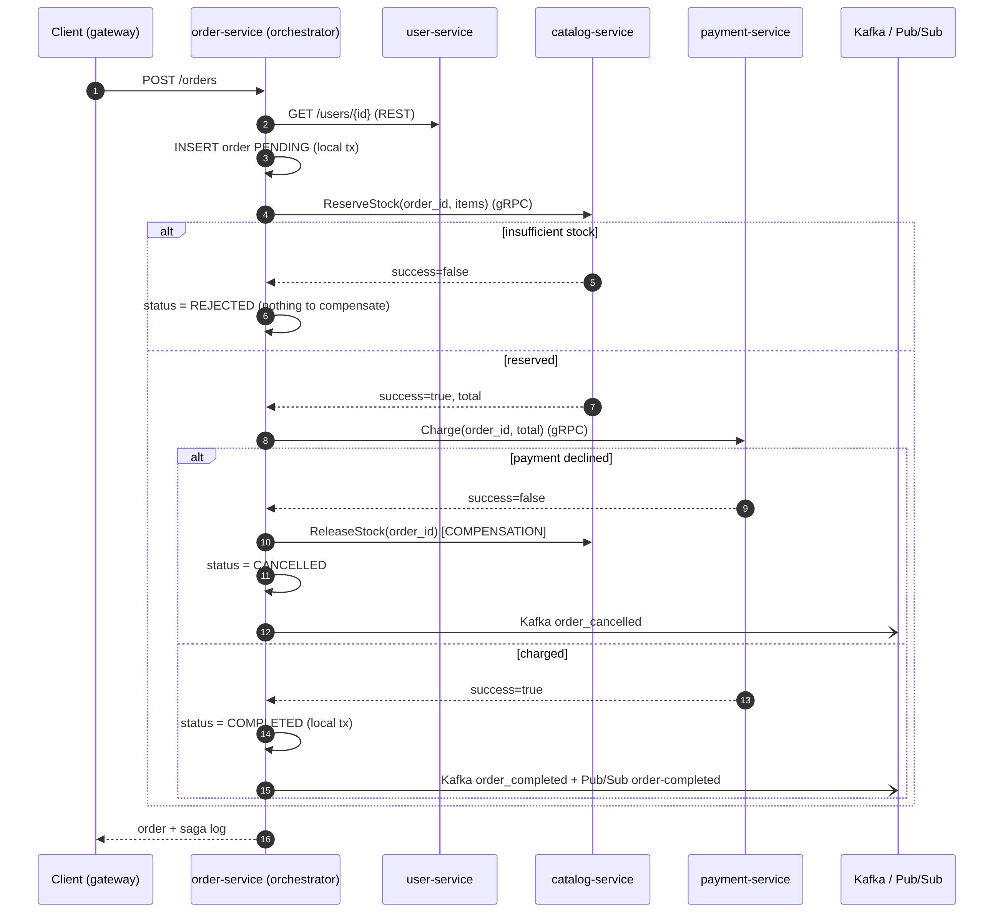
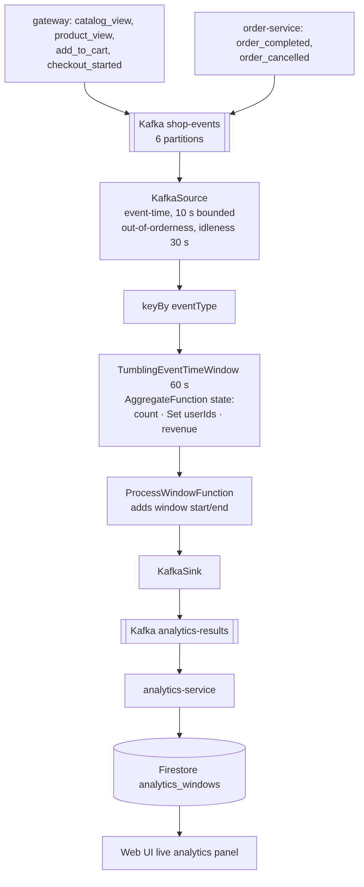

# 1. System overview

**ShopSphere** is an online store built as a set of cloud-native microservices on **Google Cloud Platform (GCP)**. A shopper opens the public web UI, browses the catalogue, adds items to a cart and checks out. Checkout is a **distributed transaction across three services that each own their own database**, so it is implemented with the **Saga pattern** (the concept for requirement *f*). Every click and every order is also streamed to **Kafka**, aggregated in real time by an **Apache Flink** job on **Dataproc** (1-minute windows: events, unique users, revenue), and the results are shown live in the UI. Completed orders trigger a **serverless Cloud Function** that generates an invoice asynchronously.

| Item | Choice |
|---|---|
| Domain | E-commerce (catalogue, accounts, checkout, payments, invoicing, analytics) |
| Concept (req. f) | **Saga pattern (orchestration) with compensating transactions** |
| Cloud | Google Cloud Platform, region `us-central1` (configurable) |
| Microservices | 8: gateway, user-service, catalog-service, order-service, payment-service, analytics-service (GKE) · invoice-function (Cloud Functions) · analytics-flink (Dataproc) |
| IaC | Terraform (two stages: `01-platform`, `02-bootstrap`) |
| Runtime | GKE Standard + HPA · Cloud Functions gen2 · Dataproc 2.2 (Flink 1.17) |
| Communication | REST, gRPC, Kafka (Managed Service for Apache Kafka), Pub/Sub |
| Storage | Cloud SQL for PostgreSQL · Firestore (Native) · Cloud Storage |
| GitOps | ArgoCD (app-of-apps) tracking `gitops/` in the GitHub repo |
| Observability | Prometheus + Grafana (kube-prometheus-stack), Loki + Promtail, Cloud Logging central bucket |

## 1.1 Requirement traceability

| Req. | What was built | Where in the repository |
|---|---|---|
| a. IaC | All infrastructure (VPC, NAT, private service access, GKE, node pool, Cloud SQL, Firestore, 3 buckets, Pub/Sub, Managed Kafka + topics, Dataproc, Cloud Function, Artifact Registry, Secret Manager, IAM/Workload Identity, WIF for CI, log bucket + sink + log metric) and the cluster bootstrap (namespace, config, ArgoCD, root app) are Terraform | `infra/terraform/01-platform`, `infra/terraform/02-bootstrap` |
| b. Serverless + comms | `invoice-function` (Cloud Functions gen2) triggered asynchronously by Pub/Sub; **REST**, **gRPC**, **Kafka** and **Pub/Sub** are all used | `functions/invoice-function`, `proto/ecommerce.proto`, §4 |
| c. Managed K8s + HPA + load test | GKE Standard; HPAs on gateway, order-service, catalog-service (CPU, + memory for order-service); k6 sustained-load script | `gitops/apps/ecommerce/hpa.yaml`, `loadtest/k6-load.js` |
| d. GitOps | ArgoCD app-of-apps; CI only commits image tags to Git; no `kubectl apply` | `gitops/argocd/*`, `.github/workflows/build-deploy.yaml` |
| e. Flink on managed cluster | Flink job on Dataproc consumes Kafka `shop-events`, stateful 1-min tumbling event-time window (count, distinct users, revenue), publishes to Kafka `analytics-results` | `analytics-flink/`, `infra/terraform/01-platform/dataproc.tf`, `kafka.tf` |
| f. Concept | Orchestrated Saga with compensations, idempotent steps, persisted saga log, demo switch to force a failure | `services/order-service/saga.py`, §5 |
| g. ≥3 storage products | Cloud Storage (object), Cloud SQL PostgreSQL (relational), Firestore (NoSQL) | `storage.tf`, `sql.tf`, `firestore.tf` |
| h. Observability | Prometheus + Grafana dashboard (RPS, error rate, latency, HPA, cluster health), Loki + Promtail, Cloud Logging central bucket incl. the Flink job and function | `gitops/argocd/monitoring.yaml`, `logging.yaml`, `gitops/apps/observability`, `logging.tf` |

# 2. Cloud deployment architecture

All resources live in one GCP project and are created by Terraform. Everything that needs private connectivity sits inside one VPC (`shopsphere-vpc`):

* **GKE Standard** zonal cluster (zonal = no management fee for one cluster), VPC-native (alias IP ranges for pods and services), Workload Identity enabled, one autoscaling node pool (`e2-standard-4`, 2–5 nodes). The cluster autoscaler adds nodes when the HPAs create more pods than fit.
* **Cloud SQL for PostgreSQL 15** with a **private IP only** (Private Service Access peering) — no public database endpoint.
* **Managed Service for Apache Kafka** cluster attached to the same subnet (Private Service Connect endpoints + private DNS), reachable from GKE pods and from Dataproc.
* **Dataproc 2.2** single-node cluster with the **Flink** optional component, internal IPs only (Cloud NAT for egress, Private Google Access for APIs).

Serverless and fully managed products sit outside the VPC: **Pub/Sub**, **Cloud Functions gen2** (Eventarc trigger), **Firestore**, **Cloud Storage**, **Artifact Registry**, **Secret Manager** and **Cloud Logging**.

| Terraform file | Resources |
|---|---|
| `network.tf` | VPC, subnet + secondary ranges, firewall, Cloud Router + NAT, private service access |
| `gke.tf` | GKE cluster, node pool, node service account |
| `sql.tf` | Cloud SQL instance, databases `users`/`catalog`/`orders`, user `app` |
| `firestore.tf` / `storage.tf` | Firestore DB `shopsphere`; buckets for invoices, Flink jars, function source |
| `pubsub.tf` / `kafka.tf` | Pub/Sub topics; Kafka cluster, topics, client SA + key in Secret Manager |
| `dataproc.tf` / `function.tf` | Flink cluster; Cloud Function, build SA, trigger IAM |
| `iam.tf` / `cicd.tf` | Workload Identity for pods; Workload Identity Federation for GitHub Actions |
| `logging.tf` | Central log bucket, sink, log-based error metric |
| `02-bootstrap/main.tf` | Namespace, `platform-config` ConfigMap, `platform-secrets` Secret, ArgoCD, root Application |

# 3. Microservices architecture

## 3.1 Responsibilities

| # | Service | Runtime | Interface | Owns data in | Responsibility |
|---|---|---|---|---|---|
| 1 | **gateway** | GKE (HPA) | REST (public LB) | — | Serves the web UI; API gateway / BFF for the UI; calls catalog over gRPC and the others over REST; publishes click-stream events to Kafka |
| 2 | **user-service** | GKE | REST | Cloud SQL `users` | Customer accounts (create / get / list); seeds demo users `u-0001…u-0200` |
| 3 | **catalog-service** | GKE (HPA) | gRPC | Cloud SQL `catalog` | Products and inventory; `ReserveStock` / `ReleaseStock` as local ACID transactions with row locks, idempotent per order |
| 4 | **order-service** | GKE (HPA) | REST | Cloud SQL `orders` (orders, items, saga_log) | Checkout API and **Saga orchestrator**; publishes order events to Kafka and Pub/Sub |
| 5 | **payment-service** | GKE | gRPC | Firestore `payments` | Simulated payment gateway; `Charge` / `Refund`, idempotent per order; configurable decline rate |
| 6 | **analytics-service** | GKE | REST + Kafka consumer | Firestore `analytics_windows` | Consumes Flink results, stores them, serves `/analytics/latest` and `/analytics/summary` |
| 7 | **invoice-function** | Cloud Functions gen2 | Pub/Sub event | GCS `invoices/`, Firestore `invoices`, `notifications` | Asynchronous invoice generation + customer notification record (idempotent on redelivery) |
| 8 | **analytics-flink** | Dataproc (Flink) | Kafka in/out | Flink keyed state (HDFS checkpoints) | Real-time 1-minute tumbling-window aggregation per event type |

Every service is stateless (state lives in managed stores), logs JSON to stdout and exposes Prometheus metrics with the same names (`app_requests_total`, `app_request_duration_seconds`), so one dashboard covers both REST and gRPC services.

# 4. Interconnection mechanisms

| From → To | Mechanism | Why this mechanism |
|---|---|---|
| Browser → gateway | REST/JSON over HTTP (L4 LB) | Universal client support |
| gateway → user / order / analytics; order → user | **REST** (httpx) | Simple request/response CRUD, easy to debug, JSON is natural for the UI |
| gateway → catalog; order → catalog, payment | **gRPC** (protobuf contract `proto/ecommerce.proto`) | Hot path with high call volume: binary encoding, HTTP/2 multiplexing, strongly typed contract between saga participants, deadlines (5 s) |
| gateway, order → Flink | **Kafka** topic `shop-events` (6 partitions, key = user id) | High-throughput, replayable event log; Flink needs a partitioned, ordered stream with offsets for exactly-once state |
| Flink → analytics-service | **Kafka** topic `analytics-results` | Decouples the stream job from its consumers; results can be replayed |
| order → invoice-function | **Pub/Sub** topic `order-completed` (Eventarc push) | Native serverless trigger, at-least-once delivery with retries, scale-to-zero consumer |

**gRPC load balancing.** gRPC keeps one long-lived HTTP/2 connection, so a normal ClusterIP Service would pin each client to one pod and new HPA pods would get no traffic. The gRPC services therefore use **headless Services** (DNS returns all ready pod IPs), clients use `dns:///` targets with the **`round_robin`** policy, and servers set `max_connection_age = 30 s` so clients periodically reconnect and discover new pods.

**Kafka security.** Managed Kafka accepts only authenticated TLS connections. Clients use SASL/PLAIN over TLS with a dedicated service account (`roles/managedkafka.client`); its key is created by Terraform, stored in Secret Manager and injected into pods as a Kubernetes Secret, and into the Flink job at submission time.

# 5. Concept: Saga pattern (requirement f)

**Problem.** A checkout touches three databases owned by three services: stock in Cloud SQL `catalog`, money in Firestore `payments` and the order in Cloud SQL `orders`. A single ACID transaction (two-phase commit) across a relational database and Firestore is not available, and it would couple the services' availability.

**Solution.** `order-service` runs an **orchestrated saga** (`services/order-service/saga.py`). Each step is a local transaction paired with a compensating action:

| Step | Action (participant) | Compensation |
|---|---|---|
| 1 `reserve_stock` | `catalog.ReserveStock` – row-locked decrement + reservation rows | `catalog.ReleaseStock` – restore stock, mark reservation RELEASED |
| 2 `charge_payment` | `payment.Charge` – ledger entry CHARGED/DECLINED | `payment.Refund` – mark REFUNDED |
| 3 `confirm_order` | order → COMPLETED | — (last step) |

If step *n* fails, the orchestrator runs the compensations of steps *n-1 … 1* in reverse order. The design handles the usual failure modes:

* **Idempotency.** Every participant operation is keyed by `order_id`, so retries and duplicate compensations are safe.
* **Unknown outcome.** If a step fails with an infrastructure error (timeout / UNAVAILABLE), the remote side may have applied it, so the orchestrator also compensates that step. A business rejection (`StepFailed`) is not compensated because nothing was applied.
* **Retrying compensations.** Each compensation is retried up to 3 times.
* **Audit trail.** Every transition is written to the `saga_log` table, shown in the UI and exposed at `GET /orders/{id}/saga`. It is also counted in the Prometheus metric `saga_transitions_total{step,outcome}`.
* **Final states.** `COMPLETED`, `REJECTED` (failed at step 1, nothing to undo) or `CANCELLED` (compensated).

**Demo.** (1) A normal order completes. (2) With *simulate payment failure* ticked, step 2 fails and the log shows `reserve_stock COMPENSATE SUCCEEDED`; the product's stock is restored. (3) Ordering 5 × "Limited Edition Sneakers" (stock 3) is REJECTED at step 1. A local concurrency test with 40 simultaneous single-item orders for the 3-unit product produced exactly 3 COMPLETED and 37 REJECTED orders with final stock 0: no overselling.

# 6. Real-time stream processing (requirement e)

* **Source:** `KafkaSource` on `shop-events`, JSON → `ShopEvent`. Malformed records are skipped, not fatal.
* **Time:** event time from the event's `ts` (Kafka timestamp as fallback), bounded out-of-orderness 10 s, idleness 30 s so quiet partitions don't stall watermarks.
* **Stateful window:** `keyBy(eventType)` → `TumblingEventTimeWindows(60 s)` → incremental `AggregateFunction` whose accumulator (count, **set of distinct user ids**, revenue) lives in Flink keyed state. Checkpoints run every 30 s.
* **Sink:** `KafkaSink` → `analytics-results` with records like `{"windowStart":…, "windowEnd":…, "eventType":"order_completed", "eventCount":42, "uniqueUsers":17, "revenue":81234.0}`.
* **Deployment:** the CI workflow builds and tests the fat jar (Maven), uploads it to GCS and submits it with `gcloud dataproc jobs submit flink` (`scripts/submit-flink-job.sh`). The job's logs go to Cloud Logging through Dataproc's job/YARN logging properties.

# 7. Storage design (requirement g)

| Product | Type | Data | Why |
|---|---|---|---|
| **Cloud SQL for PostgreSQL** | Managed relational | users, products + reservations, orders + items + saga_log (database-per-service) | Strong consistency, `SELECT … FOR UPDATE` for stock, foreign keys, transactions per saga step |
| **Firestore (Native)** | Managed NoSQL document | payments ledger, analytics windows, invoices, notifications | Schemaless, high write throughput, serverless scaling, easy access from Cloud Functions |
| **Cloud Storage** | Object store | invoice HTML files, Flink jars, function source | Cheap durable blobs, lifecycle rule moves invoices to Coldline after 1 year |

Each microservice owns its schema; no service reads another service's tables.

# 8. Scalability and resilience (requirement c)

* **HPAs** (`autoscaling/v2`): `gateway` 2–10 replicas @ 60 % CPU; `order-service` 2–8 @ 60 % CPU or 80 % memory; `catalog-service` 2–8 @ 60 % CPU. Fast scale-up (×2 every 30 s), conservative scale-down (120 s stabilisation, −1 pod/min).
* **Cluster autoscaler** grows the node pool (2→5) when pods are pending.
* **Resilience:** readiness/liveness probes (HTTP and native gRPC), PodDisruptionBudgets, rolling updates with `maxUnavailable: 0`, topology spread across nodes, gRPC deadlines, saga compensations, idempotent consumers.
* **Load test:** `loadtest/k6-load.js` ramps to 200 virtual users and holds them for 6 minutes (55 % catalogue list, 25 % product detail, 12 % add-to-cart, 8 % checkout). Thresholds: error rate < 5 %, p95 browse < 800 ms, p95 checkout < 3 s. During the run, `kubectl get hpa -w` and the Grafana *HPA current vs desired* panel show the scale-out; after the ramp-down they show the scale-in.

# 9. GitOps and CI/CD (requirement d)

1. Terraform stage 02 installs ArgoCD and one **root Application** pointing at `gitops/argocd/`. That folder declares four child Applications: `shopsphere-ecommerce` (Kustomize), `kube-prometheus-stack` (Helm), `loki-stack` (Helm) and `shopsphere-observability` (dashboards).
2. A push to `main` runs **GitHub Actions**: unit tests → build the 6 images → push them to Artifact Registry tagged with the commit SHA. CI authenticates with **Workload Identity Federation**, so no JSON keys are stored in GitHub.
3. CI then runs `kustomize edit set image …:<sha>` and **commits** the change to `gitops/apps/ecommerce/kustomization.yaml`.
4. ArgoCD detects the commit and syncs it (automated, prune + self-heal). CI never talks to the cluster and nobody runs `kubectl apply`. A manual change in the cluster is reverted by self-heal.

Rollback is `git revert` of the tag-bump commit.

# 10. Observability (requirement h)

* **Metrics:** kube-prometheus-stack (Prometheus Operator, Prometheus, Grafana, node-exporter, kube-state-metrics). One `ServiceMonitor` scrapes every ShopSphere Service on its `metrics` port.
* **Dashboard "ShopSphere — Services, HPA & Cluster Health"** (provisioned from Git by the Grafana sidecar):
    * RED metrics: RPS, error-rate % and p50/p95 latency per service, per-endpoint RPS and status codes.
    * Autoscaling: HPA current vs desired replicas, CPU and memory per pod, restarts.
    * Cluster health: ready nodes, node CPU and memory, running/pending pods, unavailable deployments.
    * Business: saga transitions, Kafka/Pub/Sub publish rate, Flink results consumed.
    * A Loki logs panel.
* **Logging:**
    * **Loki + Promtail** collect every pod's JSON logs, queryable in Grafana.
    * **Cloud Logging** receives GKE workload logs, the **Flink job** logs (Dataproc driver and YARN container logging enabled) and the **Cloud Function** logs. A project **log sink** routes all three into one `shopsphere-central` log bucket (30-day retention).
    * A log-based metric `shopsphere_error_logs` counts ERROR entries across all components.

# 11. Security

* **Credentials:** no service-account keys in pods for Google APIs. Pods use **Workload Identity** (KSA `shopsphere-app` → GSA `shopsphere-app`), and CI uses **Workload Identity Federation** restricted to this repository.
* **IAM:** least-privilege identities per component (nodes, app, Kafka client, Dataproc, function, function build, CI).
* **Network:** private-IP-only Cloud SQL; Dataproc without external IPs; Kafka reachable only from the VPC over TLS + SASL.
* **Secrets:** stored in Secret Manager and Kubernetes Secrets created by Terraform, never committed to Git.
* **Containers:** run as a non-root user, with privilege escalation disabled.

# 12. Rationale behind design choices

| Decision | Alternatives considered | Reason |
|---|---|---|
| GCP | AWS, Azure | Managed Kafka, Dataproc + Flink, Cloud Functions and GKE cover every requirement inside one provider; free trial credits |
| GKE Standard (zonal) | Autopilot, regional | Standard allows the node-exporter DaemonSet and node-level health panels; a single zonal cluster has no management fee |
| Python/FastAPI + grpcio | Java/Spring, Go | Small, readable services the whole team can demo; first-class gRPC and Kafka clients |
| Java for Flink | PyFlink | The Kafka connector, state and windowing APIs are most mature in Java; a fat jar deploys cleanly on Dataproc |
| Managed Kafka | Strimzi on GKE, Confluent Cloud | Fully managed, provisioned in the same Terraform, private VPC access for both GKE and Dataproc |
| Saga orchestration | Choreography, 2PC | The orchestrator gives one place to see and audit the flow (saga_log) and makes compensation order explicit; 2PC is not supported across Cloud SQL + Firestore |
| Database-per-service | Shared schema | Independent deployment and scaling; failure isolation |
| ArgoCD app-of-apps | Flux, CI `kubectl apply` | Visual UI for the demo, self-heal, a single bootstrap object; the assignment forbids direct apply |
| Loki + Cloud Logging | EFK | Loki is lightweight and integrates with Grafana; Cloud Logging is the only option that natively collects Dataproc and Cloud Functions logs |

# 13. Cost control and teardown

Main cost drivers are the Managed Kafka cluster (3 vCPU), the Dataproc node, Cloud SQL and the GKE nodes. Keep the stack up only for development and the demo. To tear everything down:

1. `terraform destroy` in `02-bootstrap`.
2. `terraform destroy` in `01-platform`.

# 14. Limitations and future work

* Order events are published after the local commit. A **transactional outbox** would guarantee that event and state never diverge.
* Payments are simulated. A real provider would add webhooks and a pending state.
* HTTPS with Google-managed certificates (Ingress + ManagedCertificate) and Cloud Armor for the public endpoint.
* Exactly-once Kafka sink (transactions) and a high-availability Dataproc cluster for production.
